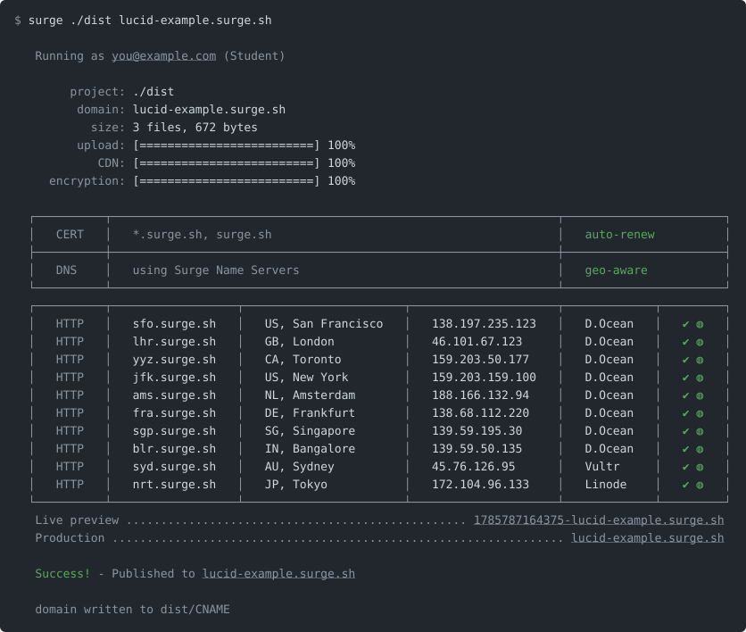

<h1 align="center"><code>surge</code> - static web publishing</h1>

One command from a directory, or a single HTML file, to a live URL. Free custom domains and SSL certificates on every plan, served from 10 regions, with over 18 million deployments published.

### Publish

    npx surge <path> <domain>

<!-- steno:publish-pair svg -->

<!-- /steno:publish-pair -->

Your project is now live in `10` regions globally! View it at `https://lucid-example.surge.sh`...

The first run asks for an email and password, which creates your account. To keep the command around, install it globally:

    npm install -g surge

### A single HTML file

    surge page.html my-page.surge.sh

The file is published as the domain's `index.html`. If the page uses images or stylesheets next to it, surge lists them; publish the folder to include them.

### Custom domains

Publish to any domain you own, then point its DNS at Surge. The certificate is provisioned for you, free.

    surge ./dist example.com

See [custom domains](https://surge.sh/docs/platform/custom-domains).

### CI and agents

Mint a token on your own machine, then pass it with `--token` wherever surge runs. No login step, no prompts:

    surge tokens add --domain example.com -m "ci"
    npx surge ./dist example.com --token <token>

The `SURGE_TOKEN` environment variable works too, and keeps the token out of shell history and logs. A token can be scoped to one domain. Publishing has [limits](https://surge.sh/docs/cli/publishing#publishing-limits) on every plan; a rate-limited publish answers with how long to wait. See [CI & automation](https://surge.sh/docs/cli/automation) for GitHub Actions and other runners.

### Documentation

[surge.sh/docs](https://surge.sh/docs/) covers publishing, revisions and rollbacks, collaborators, DNS, SSL, and the [API](https://surge.sh/docs/api/), which can do everything the CLI does.

### License

Copyright © 2012-2026 Chloi Inc. Released under the ISC License.

"Surge" is a trademark of Chloi Inc.
